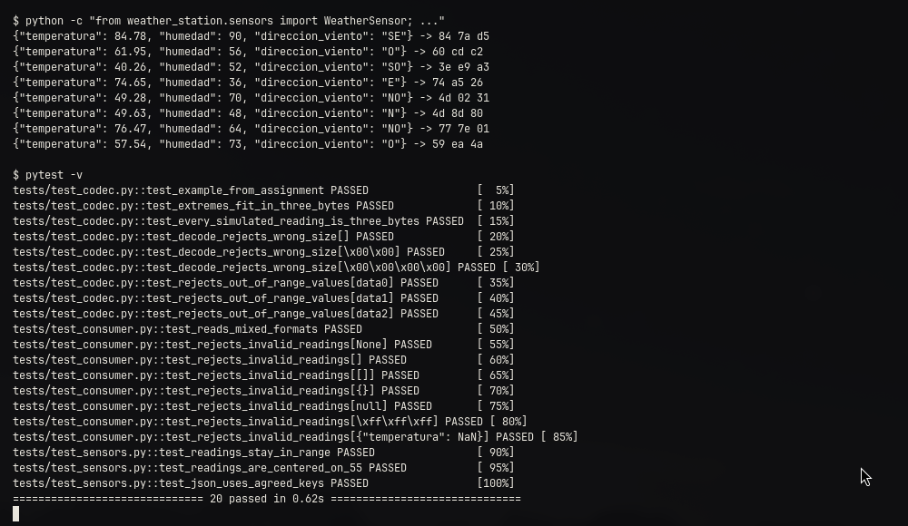

# Estación meteorológica IoT
CC3067 Redes · Universidad del Valle de Guatemala
Esteban Cárcamo (23016) · Felipe Aguilar (23195)
Simulación de sensores, publicación en Apache Kafka y visualización en vivo con Python.
Broker Edge 161.35.11.141:9092 · Topic 23016 · Repositorio: github.com/ecarcamo/IoT-Estacion-Meteorologica

# Arquitectura de la solución
Sensor simulado (WeatherSensor) → Kafka Producer (producer.py) → Broker Kafka en el Edge → topic 23016 → Kafka Consumer (consumer.py) → gráfica en vivo (matplotlib).
El productor cumple el rol del dispositivo IoT; el consumidor, el de los elementos detrás del Edge que usan la telemetría.
Autenticación SASL_PLAINTEXT con mecanismo PLAIN; las credenciales se leen de un archivo .env que no se sube al repositorio.
Dos formatos de mensaje en el mismo topic: JSON (fases 3.1 a 3.3) y 3 bytes (fase 3.4). El consumidor los distingue por su tamaño.
20 pruebas automatizadas (pytest) cubren la simulación, la codificación, la decodificación y el análisis de mensajes.

# 3.1 · Simulación de un sensor
Temperatura: normal con media 55 y desviación estándar 15 (varianza 225), recortada a [0, 110] °C y redondeada a 2 decimales.
Humedad relativa: la misma normal, recortada a [0, 100] % y redondeada a entero.
Dirección del viento: uniforme entre N, NO, O, SO, S, SE, E y NE.
Con σ = 15, el 99.7 % de las muestras cae en 55 ± 45 = [10, 100]: casi nunca hay que recortar y la gráfica muestra variación visible.
Cada lectura se serializa a JSON: {"temperatura": 56.32, "humedad": 51, "direccion_viento": "SO"}.

# 3.1 · Evidencia: lecturas generadas y pruebas
Lecturas simuladas en JSON con su codificación de 3 bytes, y las 20 pruebas automatizadas aprobadas.

# 3.1 · Preguntas
## ¿A qué capa pertenece JSON/SOAP según el modelo OSI y por qué?
A la capa 6, Presentación: definen cómo se representan y serializan los datos (sintaxis, tipos, codificación en texto UTF-8) para que dos sistemas distintos los entiendan, sin ocuparse de cómo se transportan. SOAP, como protocolo de mensajería sobre HTTP, también se ubica en la capa 7, Aplicación.
## ¿Qué beneficios tiene utilizar un formato como JSON/SOAP?
Es independiente del lenguaje y la plataforma, autodescriptivo y legible (facilita depurar), extensible (se agregan campos sin romper consumidores) y tiene librerías y validación estándar (JSON Schema, XSD). Desacopla productor y consumidor. Su costo es el tamaño: nuestra lectura pesa 63 bytes en JSON y 3 en formato compacto.

# 3.2 · Envío de datos al servidor Edge
producer.py crea un KafkaProducer hacia 161.35.11.141:9092 y publica en el topic 23016 con key sensor1.
Envía una lectura cada 15 a 30 segundos (intervalo aleatorio) y sigue corriendo hasta que se interrumpe con Ctrl+C.
Usa acks="all" y espera la confirmación del broker en cada envío; imprime la partición y el offset asignados.
La key fija hace que todas las lecturas caigan en la misma partición, así se conserva su orden.
Ejecución: python producer.py (JSON) · python producer.py --compact (3 bytes).

# 3.2 · Evidencia: productor publicando en el broker
Cinco lecturas en JSON y cinco en 3 bytes, a intervalos de 15–30 s. Cada línea muestra la confirmación del broker con partición y offset.

# 3.3 · Consumir y desplegar los datos
consumer.py crea un KafkaConsumer suscrito al topic 23016 con los mismos parámetros de autenticación.
Usa poll con una espera corta y plt.pause, así la ventana de la gráfica sigue respondiendo entre mensajes.
La gráfica muestra la temperatura y la humedad contra la hora del mensaje, y el conteo de cada dirección del viento. Se redibuja con cada dato nuevo.
Con auto_offset_reset="earliest" también se grafica la telemetría pasada; --replay relee todo el historial sin guardar offsets del grupo.
Los mensajes inválidos se reportan en consola y no se agregan a la gráfica.

# 3.3 · Evidencia: productor, consumidor y gráfica en vivo
Ejecución real contra el broker: el consumidor (arriba a la izquierda) recibe los mismos offsets que envía el productor (abajo a la izquierda) y la gráfica se actualiza con cada lectura.

# 3.3 · Evidencia: gráfica con datos consumidos de Kafka
Lecturas JSON recibidas del topic 23016. El tramo recto inicial une las lecturas de prueba de las 20:12 con la ejecución de las 20:36.

# 3.3 · Preguntas
## ¿Qué ventajas y desventajas tiene este acercamiento basado en Pub/Sub de Kafka?
Ventajas: el sensor y quienes usan sus datos quedan desacoplados; pueden suscribirse varios consumidores independientes (gráfica, alertas, análisis); Kafka retiene los mensajes y permite releerlos por offset; las particiones reparten la carga.
Desventajas: hay que operar y mantener el broker; consume más recursos que una conexión directa y agrega un salto de red; el orden solo se garantiza dentro de una partición; hay que entender offsets y grupos para no perder ni repetir datos.

# 3.3 · Preguntas
## ¿Para qué aplicaciones tiene sentido usar Kafka? ¿Para cuáles no?
Sí: telemetría de muchos dispositivos IoT, logs centralizados, análisis en streaming, integración de microservicios y eventos que varios sistemas procesan, sobre todo si conviene poder releerlos.
No: aplicaciones pequeñas con poco tráfico, colas de tareas sencillas, comunicación petición-respuesta de baja latencia, o dispositivos muy limitados que hablan directo con el broker. Para estos últimos encajan mejor MQTT o CoAP, con un gateway hacia Kafka.

# 3.4 · Payload de 3 bytes: codificación
Temperatura: 14 bits · Humedad: 7 bits · Viento: 3 bits. Total: 24 bits = 3 bytes, big-endian.
encode (JSON → bytes): (temperatura × 100) << 10 | humedad << 3 | índice del viento.
decode (bytes → JSON): corrimientos y máscaras, y la temperatura se divide entre 100.
Ejemplo: 56.32 °C, 51 %, SO → (5632 << 10) | (51 << 3) | 3 = 0x58019B → bytes 58 01 9B.
El mismo productor y el mismo consumidor funcionan con este formato: python producer.py --compact.

# 3.4 · Evidencia: envío, consumo y gráfica con 3 bytes
Ejemplo real: el productor envió 48 8E D7 (offset 12) y el consumidor lo decodificó como 46.43 °C, 90 % y NE. La gráfica mezcla JSON y 3 bytes en el mismo topic.

# 3.4 · Preguntas
## ¿Qué complejidades introduce el tener un payload restringido (pequeño)?
El mensaje deja de describirse a sí mismo: productor y consumidor deben compartir exactamente el mismo esquema de bits y orden de bytes, y cualquier cambio obliga a actualizar ambos a la vez.
No queda espacio para versión, timestamp, id del sensor ni checksum, así que un bit corrupto cambia un valor sin que se detecte.
Hay que cuantizar y validar rangos antes de codificar, y depurar es más difícil: 48 8E D7 no se entiende a simple vista.

# 3.4 · Preguntas
## ¿Cómo podemos hacer que el valor de temperatura quepa en 14 bits?
Con punto fijo. La temperatura tiene 2 decimales y su máximo es 110.00, así que se multiplica por 100 y se guarda como entero: 56.32 → 5632.
El máximo es 11000, menor que 2^14 − 1 = 16383, así que cabe en 14 bits sin perder precisión. Al decodificar se divide entre 100.
No hace falta un float de 32 bits porque el rango y la resolución son conocidos y pequeños.

# 3.4 · Preguntas
## ¿Qué sucedería si ahora la humedad también es tipo float con un decimal? ¿Qué decisiones tendríamos que tomar?
La humedad tendría 1001 valores (0.0 a 100.0 → 0 a 1000) y necesitaría 10 bits: 14 + 10 + 3 = 27 bits, que ya no caben en 24.
Opciones: bajar la temperatura a un decimal (0 a 1100 cabe en 11 bits: 11 + 10 + 3 = 24 exactos); mantener la humedad entera; acotar los rangos reales con un offset; enviar los campos en mensajes alternados; o pedir un payload de 4 bytes.
La decisión depende de qué precisión necesita realmente quien usa los datos.

# 3.4 · Preguntas
## ¿Qué parámetros o herramientas de Kafka podrían ayudarnos si las restricciones fueran aún más fuertes?
compression_type (gzip, snappy, lz4, zstd) junto con batch_size y linger_ms: agrupan y comprimen varios mensajes por solicitud, a cambio de latencia.
max_request_size limita el tamaño de cada solicitud; acortar o quitar la key ahorra bytes, aunque quitarla afecta el orden por sensor.
Avro o Protobuf con Schema Registry permiten compartir y evolucionar el esquema compacto; un gateway MQTT en el borde, Kafka Connect o Kafka Streams pueden filtrar o resumir los datos antes de enviarlos.

# Resultados y conclusiones
Se simuló un nodo IoT que publica telemetría en un broker Kafka en el Edge y un consumidor que la grafica en vivo, primero en JSON y luego en solo 3 bytes.
Prueba contra el broker real (10 de noviembre): 16 mensajes (8 JSON y 8 de 3 bytes, offsets 4 a 19), todos recibidos y decodificados con los mismos valores enviados.
El formato compacto reduce el payload de 63 a 3 bytes (≈ 95 %), a cambio de un contrato rígido entre productor y consumidor.
Pub/Sub desacopla al sensor de quienes usan sus datos, pero tiene un costo operativo que solo se justifica con suficiente volumen o varios consumidores.
Referencias: kafka.apache.org/documentation · kafka-python.readthedocs.io
