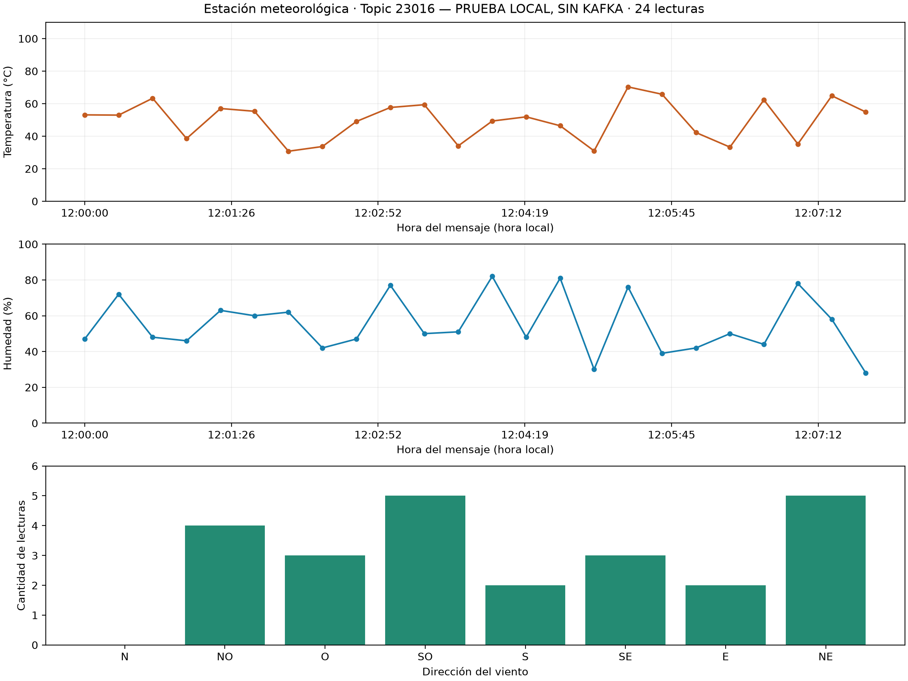

# Estación meteorológica IoT
CC3067 Redes · Universidad del Valle de Guatemala
Esteban Cárcamo y Felipe Aguilar
Simulación de sensores, Kafka y visualización en Python.
Versión para revisión: falta incorporar evidencia del broker real desde el consumidor.

# 3.1 · Simulación de sensores
Generamos temperatura entre 0 y 110 °C, con dos decimales, y humedad entera entre 0 y 100 %.
Ambas usan una normal de media 55 y desviación 15 (varianza 225), recortada al rango permitido. El viento se elige uniformemente entre ocho direcciones.
Ejemplo: {"temperatura": 56.32, "humedad": 51, "direccion_viento": "SO"}.
JSON representa los datos: corresponde a la función de presentación (capa 6 de OSI). SOAP también cumple funciones de mensajería de aplicación (capa 7).
Ventajas: formato legible, interoperable y fácil de extender. Desventaja: transmite nombres de campos y sintaxis además de los valores.

# 3.2 · Publicación hacia el Edge
Sensor simulado → productor Python → broker Kafka → topic 23016 → consumidor y gráfica.
El productor espera entre 15 y 30 segundos y continúa hasta Ctrl+C. La key sensor1 mantiene los mensajes en una partición mientras no cambie su asignación.
Usamos acks="all" y esperamos la confirmación de cada envío; imprimimos partición y offset. La durabilidad también depende de las réplicas y de la configuración del broker.
SASL/PLAIN autentica con variables de .env. SASL_PLAINTEXT no cifra el tráfico: no debe confundirse autenticación con confidencialidad.
Ejecución: python producer.py. Para tres bytes: python producer.py --compact. Falta adjuntar una captura real de esta ejecución a esta versión.

# 3.3 · Consumidor y gráfica
El consumidor distingue compacto por longitud de tres bytes; en los demás casos interpreta JSON. Verifica rangos y omite lecturas inválidas con un aviso.
La gráfica muestra temperatura y humedad contra la hora del mensaje, más conteos de viento. poll y plt.pause permiten atender la ventana entre lecturas.
python consumer.py --replay --save docs/screenshots/kafka.png
El grupo normal continúa desde sus offsets. --replay lee el historial retenido sin guardar offsets del grupo. earliest no reinicia por sí solo un grupo existente.
La gráfica es de sesión: los datos quedan en memoria. No implementamos persistencia local ni entrega exactamente una vez.

# 3.3 · Evidencia local de visualización
24 lecturas con JSON y compacto alternados. Horas artificiales; no se conectó al broker.

# 3.3 · ¿Por qué Pub/Sub con Kafka?
Ventajas: productor y consumidores independientes, historial retenido, relectura mediante offsets y procesamiento paralelo por particiones.
Desventajas: mantenimiento del broker, mayor consumo de recursos y un salto adicional de red. El orden se conserva por partición, no globalmente.
Lo usaríamos para telemetría de muchas estaciones, logs, análisis en streaming e integración de microservicios.
No lo elegiríamos para una aplicación pequeña, una cola sencilla o solicitudes con respuesta inmediata. MQTT o CoAP suelen encajar mejor en dispositivos limitados, con un gateway hacia Kafka.

# 3.4 · Codificar y recuperar en 24 bits
Temperatura: 14 bits · Humedad: 7 bits · Viento: 3 bits. Total: 24 bits = 3 bytes, big-endian.
Temperatura en punto fijo: 56.32 × 100 = 5632. El máximo 11000 cabe en 14 bits porque 2^14 - 1 = 16383.
Codificación: (5632 << 10) | (51 << 3) | 3 = 0x58019B. Decodificación: corrimientos, máscaras y división de temperatura entre 100.
58 01 9B recupera 56.32 °C, 51 % y SO. Las pruebas comprueban ida y vuelta con 5000 lecturas y rechazan tamaños incorrectos.
El ejemplo JSON ocupa 63 bytes frente a 3 del compacto: reducción del valor de aproximadamente 95.2 %. No incluye key, cabeceras ni tráfico de Kafka/TCP.

# 3.4 · Decisiones por el límite de tamaño
El formato compacto no se describe solo: ambos extremos deben compartir esquema y orden de bytes. No reservamos un campo de versión, timestamp ni checksum propio.
Si la humedad tiene un decimal, hay 1001 valores: necesita 10 bits. 14 + 10 + 3 = 27 bits, por lo que ya no cabe.
Una opción es temperatura con un decimal: 1101 valores necesitan 11 bits y 11 + 10 + 3 = 24. Otras opciones: mantener humedad entera, limitar rangos o permitir cuatro bytes.
Cambiar la precisión requiere actualizar productor y consumidor juntos. La decisión debe salir de lo que la aplicación necesita medir, no solo del tamaño disponible.

# 3.4 · Si la red fuera más limitada
compression_type comprime lotes; para tres bytes aislados puede no ahorrar. batch_size y linger_ms agrupan, a cambio de latencia; habría que dejar de esperar después de cada envío para aprovecharlos.
max_request_size limita solicitudes, no solo payload. Reducir acks puede bajar garantías; quitar la key cambia la partición y puede afectar el orden por sensor.
Avro/Protobuf y Schema Registry facilitan evolución, pero su envoltura no necesariamente cabe en tres bytes.
Un gateway MQTT puede filtrar o resumir antes de publicar. Connect integra fuentes; Streams procesa eventos del cluster. Procesar después del broker no reduce el tráfico que el sensor ya envió.

# Pruebas y pasos pendientes
20 pruebas automatizadas aprobadas: sensores, codificación y decodificación, formatos mixtos y rechazo de mensajes inválidos.
Visualización local: 24 puntos por línea, barras que suman 24 y revisión de los estados vacío y con datos. La captura no demuestra conectividad ni autenticación Kafka.
Pendiente: configurar la contraseña en .env, ejecutar ambos modos a intervalos de 15–30 s y capturar gráfica, consola y offsets reales. Probar cierre de ventana y Ctrl+C conectados.
Después: sustituir la imagen local, regenerar el PDF y subir código y evidencia a Canvas. No se realizó una entrega ni un push desde esta ejecución.
Base de las respuestas: docs/producer-answers.md y docs/consumer-answers.md. Referencias: kafka.apache.org/documentation/ y kafka-python.readthedocs.io.
